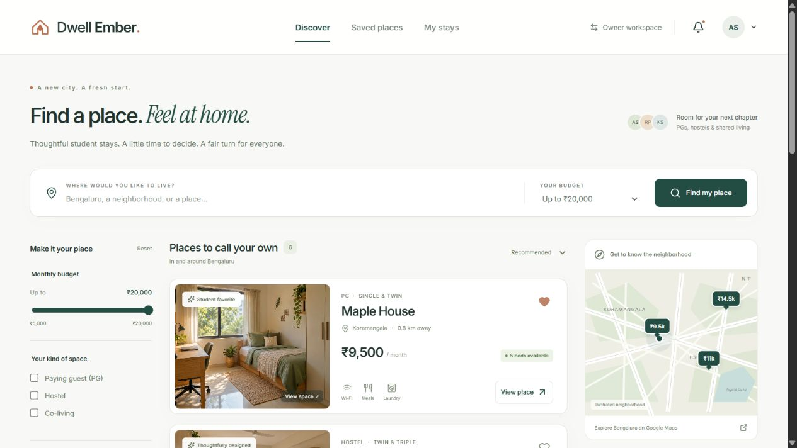
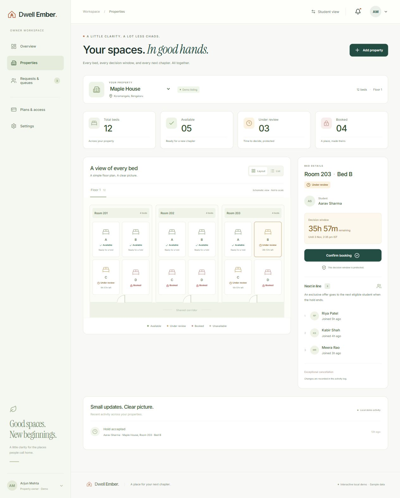
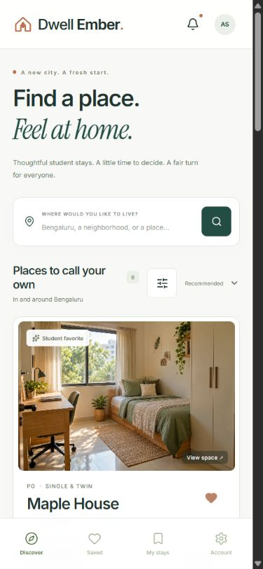

# Dwell Ember — Implemented Application Screenshots

Captured from the working local Next.js application during browser QA on 2 November 2026. These are screenshots of implemented screens, distinct from the earlier generated UI concepts.

## Desktop discovery

## Owner inventory

## Mobile discovery

The app uses fictional sample records and generated property photos. Supabase login, real checkout, external delivery and interactive maps are not connected; see [implementation status](../../docs/IMPLEMENTATION_STATUS.md).

Public landing page: [desktop](landing-desktop.jpg) · [mobile](landing-mobile.jpg). These show the current public homepage; prior discovery captures show the earlier seeded demo.

[Location picker check](location-picker-check.jpg) shows the real map components in a temporary isolated preview, not a saved property. The temporary route was removed after verification.

[Property structure check](property-structure-check.jpg) shows the actual shared editor during isolated browser verification of multiple floors, rooms, independent bed counts and main-image selection. No listing was saved.

[Owner hierarchy editor](owner-hierarchy-check.jpg) shows the revised floor/room/bed-slot editor in an isolated browser check on 3 November 2026. It supersedes the earlier count-based structure editor; no listing was saved by the check.

[Owner status controls](owner-status-controls.jpg) shows the actual three status choices in an isolated visual check; no reservation was saved.
