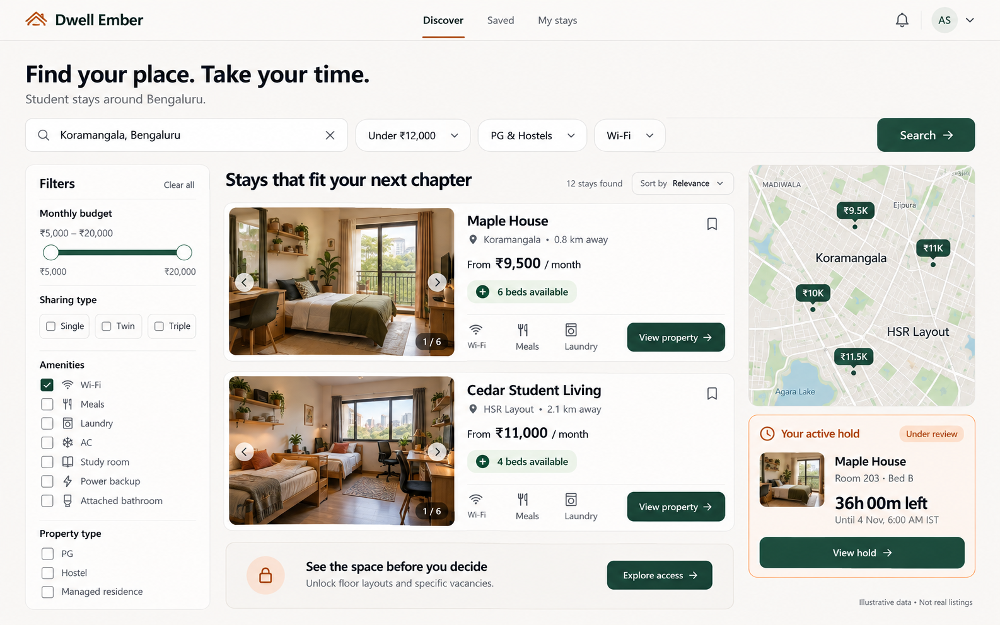
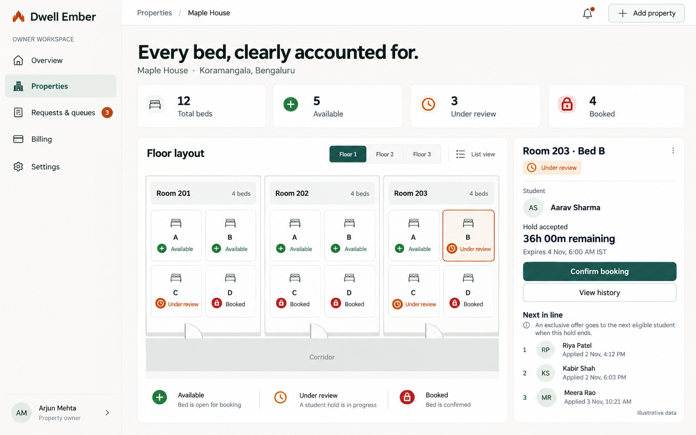
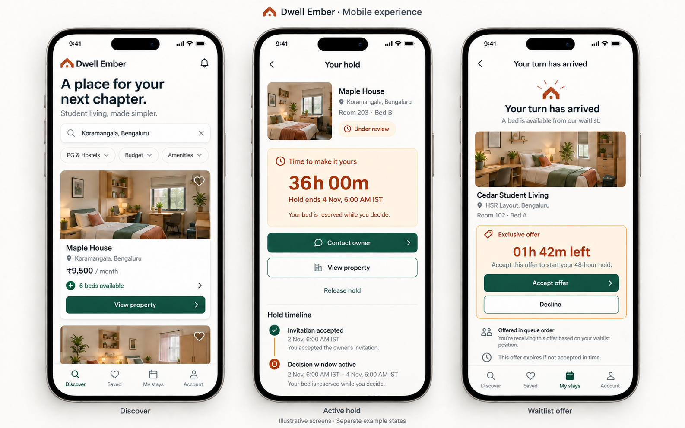

# Dwell Ember — UI Concepts

Generated 2 November 2026 with the built-in image generation tool from the project's UI/UX specification.

## Student discovery dashboard

Search, budget/sharing filters, property cards, map, private personal hold summary and a layout-access prompt. Public listing cards show aggregate counts, while the personal hold card shows only the student's own bed.

## Owner inventory dashboard

Property navigation, summary counts, a schematic floor with twelve bed markers, selected hold details and FIFO queue. The illustration has five available beds, three under review and four booked.

## Mobile student experience

Three separate illustrative states: discovery, active hold and an exclusive waitlist offer. The accepted hold has a 48-hour decision window; a queue offer has its own two-hour acceptance period before a new hold begins.

## Use and limitations

These images establish a visual direction for implementation. They are raster mockups, not screenshots of a built application or editable Figma designs. Final components must follow the normative [UI/UX specification](../../docs/UI_UX.md), including amber/yellow hold badges, accessible contrast and exact server-derived timestamps. All listing data, maps, photos and identities are fictional. The small logo symbols are exploratory and not a finalized brand asset.

The full generation prompts and mobile timestamp correction are preserved in [PROMPTS.md](PROMPTS.md).
