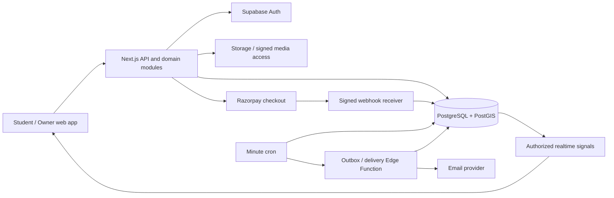

# Dwell Ember — Architecture and Technical Decisions

## 1. Recommended foundation

Use a modular Next.js application with domain modules for identity, catalog, inventory, allocations, queues, access, billing and notifications. A separate worker deployment handles external delivery; database transactions own allocation integrity. A solo founder should operate a small number of managed services, not a microservice fleet.

| Concern | Choice | Rationale |
|---|---|---|
| Web/API | Next.js App Router + TypeScript | SEO discovery, responsive dashboard and one application deployment |
| Components | Tailwind, shadcn/ui, Radix | Accessible base primitives and a consistent product design system |
| Forms/data | React Hook Form, Zod, TanStack Query | Validated forms, cache invalidation and live dashboard refresh |
| Identity | Supabase Auth + SSR cookie integration | Managed sessions; verify claims server-side, do not trust client role metadata |
| Data | PostgreSQL + PostGIS on Supabase, Mumbai | Transactional allocation plus radius search |
| Schema | SQL migrations + generated TS types | Explicit indexes/RLS; no ORM abstraction needed for critical transitions |
| Storage | Supabase Storage | Public approved photos; private layout assets and quarantine |
| Realtime | Supabase Realtime private broadcasts | Change signals scoped to authorized audiences |
| Jobs | Supabase Cron + Edge Functions | Minute-level reconciliation and outbox relay without a persistent server |
| Payments | Razorpay | India-first recurring plans and one-time credit purchases |
| Maps | Google Maps JS + Places | Pinning, geocoding and locality discovery |
| Hosting | Vercel Node runtime | Managed builds; place database-dependent compute near Mumbai |
| Observability | Sentry, structured logs, external uptime check | Trace failures and monitor the business workflows |
| Verification | Vitest, Playwright, pgTAP, k6 | Domain tests, role journeys, SQL isolation/integrity, load |

Pin supported stable versions and lockfiles when scaffolding; do not copy an old major version from a document. Do not add Redis, Elasticsearch, Kubernetes or independently deployed API services until measured requirements justify them.

## 2. Component flow

Inventory request: validate session → authorize membership/entitlement → execute one command RPC/transaction → commit allocation + queue + audit + inbox/outbox → return canonical DTO → deliver email/broadcast asynchronously. Database command functions are implemented in phase 2; schema DDL alone is not the business engine.

## 3. Trust boundaries

- Next.js route handlers expose the OpenAPI interface. Browser SDK access is limited to identity, authorized storage operations and realtime.
- Inventory command functions check `auth.uid()` or a dedicated worker role, fixed search paths and explicit grants. If a definer function bypasses RLS, its authorization checks are mandatory.
- Do not let clients supply arbitrary `organization_id`, impersonated `student_id`, wallet amounts, paid-through dates or bed colors. Derive tenant ownership and payment fulfillment server-side.
- General runtime code uses user-scoped JWT RPCs or a restricted server database role. Service-role keys exist only in isolated billing/worker modules that require them.
- Minimal public DTOs carry counts, not raw private rows. Private floor images cannot be hidden only with CSS; protect the storage bucket and signed URL issuance.
- Admin support access is a separate audited command surface, not a client-side role switch.

## 4. Integrity and background work

PostgreSQL is the only authority for commitments. Use row locks and unique constraints; Redis locks and browser timers are not required. Use READ COMMITTED with explicit bed locks, bounded timeouts and retries for transient database conflicts.

The outbox record lives beside each mutation in the same commit. Delivery can duplicate after a crash, so use event/delivery idempotency. Realtime is a prompt to refresh, not a replacement for database reads. Background jobs scan durable deadlines; no 48-hour in-process timeout or long-running serverless function.

Cron calls a restricted database reconciliation function every minute. A separate invocation runs the outbox Edge Function; HTTP scheduling failure does not lose events because it polls durable undelivered records next time. External network requests never hold inventory locks. The `pg_net` invocation mechanism should be pinned/tested because its API is documented as beta.

## 5. Performance and scaling

Start with PostGIS GiST location indexes and B-tree indexes on published properties, price, room filters, active allocations, due deadlines and queue sequence. Cursor pagination prevents deep offset scans. Limit search radius/results and image payloads; lazy-load Maps and layouts.

Use the Supabase Data API/RPC connection pool for serverless commands. If direct SQL is required, use transaction pooling with small application pools and no unsupported session state/prepared statements. Use direct migration connections for DDL.

Cache public descriptions/photos at the CDN; use short-lived aggregate count caches with `asOf`. Premium/personal responses use `Cache-Control: private, no-store`. Never cache an allocation decision. Canonical availability reads prefer the primary; read replicas must not authorize booking from stale state.

Measure before scaling: database lock wait, p95 query/command duration, connection saturation, outbox age and realtime fan-out. Scale database compute/indexes first, then bounded workers and public cache. Add external search for demonstrated ranking/query limitations; isolate workers/services only when their scaling or reliability needs diverge. Preserve the transactional database command boundary through those changes.

## 6. Future capabilities

Hourly stays need a shared time-range reservation table with `tstzrange` and exclusion constraints per bed, including long-stay ranges and cleaning buffers. Use half-open `[start,end)` intervals. Open-ended long stays block overlapping short bookings. Do not run two independent inventory engines.

AI can convert natural-language queries into allowed filter values and draft descriptions for owner review. Keep provider calls behind an adapter, budget limits and data access checks. Do not pass applicant PII unnecessarily. AI must not reorder FIFO, infer sensitive eligibility or perform allocation/payment writes. AI provider selection is deferred because the user chose AI after core launch.

## 7. Official references used

- [Next.js self-hosting and deployment behavior](https://nextjs.org/docs/app/guides/self-hosting)
- [Supabase regions](https://supabase.com/docs/guides/platform/regions)
- [Supabase database connections](https://supabase.com/docs/guides/database/connecting-to-postgres)
- [Supabase Cron](https://supabase.com/docs/guides/cron)
- [Supabase pg_net](https://supabase.com/docs/guides/database/extensions/pg_net)
- [PostgreSQL explicit locking](https://www.postgresql.org/docs/current/explicit-locking.html)
- [PostgreSQL range/exclusion constraints](https://www.postgresql.org/docs/current/rangetypes.html)
- [Transactional outbox pattern](https://docs.aws.amazon.com/prescriptive-guidance/latest/cloud-design-patterns/transactional-outbox.html)
- [Razorpay webhook validation](https://razorpay.com/docs/webhooks/validate-test/)
- [Google Maps key security](https://developers.google.com/maps/api-security-best-practices)

Provider features, pricing and package versions must be rechecked during provisioning. No current-price infrastructure estimate is represented as a quote.
