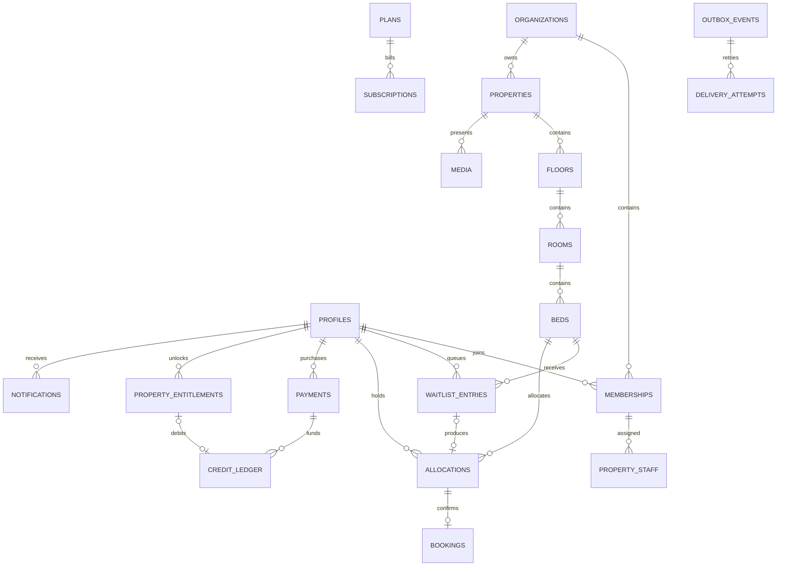

# Dwell Ember — Database Design

## 1. Execution and limits

`database/schema.sql` is complete initial DDL for a fresh Supabase PostgreSQL project. It creates tables, types, indexes, read-policy helpers and immutable-record triggers. It is **not** a complete production migration set: command functions, expiry jobs, admin commands, storage policies and provider fulfillment are work packages in the implementation plan.

Use Supabase migrations to apply the schema as migration owner. `auth.users`, `auth.uid()`, `anon` and `authenticated` must exist. The migration installs `pgcrypto` and `postgis` in `extensions`; confirm the actual project's extension placement before applying it to an existing project. Do not apply this bootstrap to an occupied database or rewrite the initial migration after production use.

## 2. Entity relationships

## 3. Dictionary by subsystem

| Tables | Responsibility / important fields |
|---|---|
| `profiles` | Auth-linked display name, active state, optional E.164 phone; verified email comes from Auth |
| `organizations`, `memberships`, `property_staff` | Tenant boundary, owner/staff role, active membership and explicit staff assignments |
| `properties` | Public listing, INR price, audience policy, PostGIS point, publishing approval and freshness |
| `floors`, `rooms`, `beds` | Hierarchy, schematic coordinates, sharing capacity, operational flags, concurrency version |
| `amenities`, `property_amenities`, `media` | Controlled amenities, public photos/private layouts and approval metadata |
| `saved_properties` | Student's saved listings |
| `bed_access_invitations`, `bed_access_grants` | Hashed account-bound queue invitation redemption and 14-day bed access |
| `waitlist_entries` | Immutable ordering sequence, lifecycle and closure reason; no public student list |
| `allocations` | Initial invitation, exclusive queue offer, accepted hold, booked allocation and history |
| `bookings` | Offline agreement record linked to the exact bed/student allocation |
| `plans`, `subscriptions` | Audience-specific paid capabilities and paid-through intervals |
| `payment_events`, `payments` | Verified provider inbox, processing/reconciliation, captured payments and purchase attribution |
| `property_entitlements`, `credit_ledger` | Thirty-day property access and immutable integer credit movements |
| `notifications`, `outbox_events`, `delivery_attempts` | Durable inbox, queued external effects, leases/retries and provider outcomes |
| `audit_events`, `idempotency_requests` | Append-only trace and 24-hour request replay records |

`id` values are UUIDs; money is integer paise; `timestamptz` values represent UTC instants. Queue sequence is a `bigint`, sent as a decimal string in JSON if exposed internally to avoid JavaScript precision loss. Public API returns ordinal position, not sequence IDs.

## 4. Enforced versus transactional invariants

| Invariant | Enforcement |
|---|---|
| At most one active allocation per bed | Partial unique index including invited/offered/held/booked |
| At most one pending/held commitment per student | Partial unique index excluding booked |
| One live queue entry per student/bed | Partial unique index on waiting/offered |
| Offer belongs to exact queued student and bed | Composite foreign key |
| Booking belongs to exact allocation/student/bed | Composite foreign key plus one open booking index |
| Room/floor/bed property matches | Composite hierarchy foreign keys |
| Invitation/offer window = two hours | Allocation CHECK constraint |
| Hold between one and 48 hours; promoted hold 48 hours | CHECK constraints |
| Held deadline equals acceptance + agreed duration | CHECK constraint |
| History/ledger not silently rewritten | Audit/credit mutation-blocking triggers, restricted privileges |
| Queue cap of three per student | Command transaction + student-cap advisory lock; not a row CHECK |
| Wallet never negative | Profile lock + balance calculation + ledger insert in one command |
| Booking state agrees with allocation | Command transaction and invariant reconciler; FK alone cannot verify state |
| FIFO / eligibility / no commercial override | Bed-locked command functions + tests + audit |
| Number of beds does not exceed room capacity | Inventory command with room lock and check; schema permits historical disabled beds |
| Unlock belongs to debit's student | Unlock command validates relation; no direct ledger writes |
| Notification intent accompanies each transition | Insert inbox/outbox/audit within the command transaction |

Do not use a partial index with `expires_at > now()`; time is not immutable. Expired rows leave active states through reconciliation. Indexes correctly keep them exclusive until the owning transition closes them.

## 5. Required command-function contracts

Implement these functions in ordered migrations, with fixed search path and revoked PUBLIC execution. User commands derive actor from verified `auth.uid()`. Workers use a separate restricted capability. RPCs return canonical response data and idempotency result, not arbitrary raw table rows.

| Command | Transaction behavior |
|---|---|
| `invite_bed` | Check owner plan/resource permissions, lock bed, reconcile, promote prior eligible queue first; if still free create INVITED allocation, inbox, audit/outbox |
| `accept_allocation` | Lock bed; recheck owner/subject and exact deadline/version; INVITED/OFFERED → HELD, convert queue entry if applicable, set accepted/deadline and emit |
| `release_allocation` | Student declines/releases; close allocation, update linked offered entry, promote, emit |
| `confirm_booking` | Lock bed; reconcile; only current unexpired HELD; create booking, state BOOKED, clear expiry, close queues, emit |
| `cancel_exceptionally` | Check owner/delegated capability and reason; lock bed, cancel yellow allocation, block bed; notice all affected queues without promoting |
| `end_booking` | Lock bed, close booking/allocation, emit then promote if operationally eligible |
| `join_waitlist` | Acquire student-cap lock then bed lock, reconcile, verify entry access/queue cap/state; insert sequence under lock |
| `leave_waitlist` | Lock bed, close WAITING entry or release exclusive OFFERED allocation and advance queue |
| `promote_next` | Private helper called while bed lock held; oldest eligible WAITING; unique conflict on student allocation handled and re-evaluated |
| `reconcile_due` | Worker batches bed locks using SKIP LOCKED; per-bed expire and promote; commands call same helper |
| `unlock_property` | Lock profile; existing subscription/entitlement returns no debit; otherwise verify credits and atomically grant + debit |
| `fulfill_payment` | Verified worker locks payment; checks capture and amount/catalog snapshot; grant once using permanent fulfillment key |

Command functions also write request replay records in the same transaction. On an expiry race, a command may commit required reconciliation and return a 409 result rather than raising an exception that would roll reconciliation back. Distinguish business rejection returned as data from unexpected SQL failure that must abort.

## 6. Queries and privacy

- Public discovery selects only approved public fields plus aggregate eligible counts and `asOf`; no public raw property table grants.
- Full detail reads require `has_property_details`, including organization operator access. Free own-bed tracking joins only the subject's allocation/queue DTO and does not unlock neighboring beds.
- Schema read policies cover floor/room/bed data only; operational tables default-deny. Server functions provide filtered projections for own inbox, queues and billing.
- Privileged helpers must not return arbitrary tenant data. A guessed resource ID is never enough authorization.
- Schema `updated_at` and `version` fields are intentionally managed by commands; no generic trigger replaces domain updates or audit.

## 7. Migration, backups and future evolution

Baseline migration → helper/command functions → storage policies → cron jobs → controlled seed catalog. Keep local/test/prod separate. Use expand/migrate/contract for later incompatible changes; rehearse restore on staging and verify storage files separately from database backup.

Hourly stays will add interval allocations with PostgreSQL range exclusion constraints on both long and short stays. Create and backfill that model behind a feature flag before changing the active-allocation unique index. Future migrations must not permit hourly sales alongside the existing global bed lock without a shared conflict rule.
